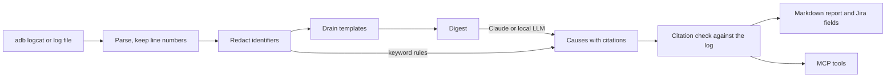

# Android Bug Triage Agent

Turns Android logcat and radio logs into a draft bug report. Every suggested cause links back to the
original log lines, and a program checks those links, so an invented line cannot reach the report.

A portfolio project by an Android QA engineer, and a practical follow-up to a master's thesis on AI-assisted
analysis of Android communication logs. It uses only synthetic and public logs. Developed with Claude Code.

## Project status

| Part | State |
|---|---|
| Parsing, redaction, Drain templates, citation check, reports, CLI | Working, covered by tests |
| Keyword analyzer (offline baseline) | Working, scored below |
| MCP server | Working, tested over stdio with an MCP client |
| Local LLM analyzer (Ollama, `qwen3:8b`) | Working, run on real hardware and scored below |
| Claude API analyzer | Request and response handling tested against a fake network. **Not yet run against the live API, so it has no accuracy result** |
| Claude Code CLI analyzer | Same prompt through a Claude Code login. Its only run used an earlier version of the dataset and digest, so it is not reported here |
| ADB collection | Tested with a fake `adb`. **Not yet run on a real device** |

## How it works



| Module | Job |
|---|---|
| `collect.py` | Dumps the main, system, crash and radio buffers with `adb logcat -d`. It never clears device logs |
| `parse.py` | Splits `threadtime` lines into fields and keeps the original line number |
| `redact.py` | Masks IMEI, IMSI, ICCID, phone numbers, IP and MAC addresses, emails and SIP URIs before anything else sees the text |
| `templates.py` | Groups lines with Drain, then builds a digest: severe and rare templates first, each with real sample lines, including rare wordings Drain merged |
| `llm.py` | Sends the digest to Claude once and gets back JSON that follows a fixed schema |
| `ollama.py` | Sends the same digest to a local model through Ollama, so logs stay on the machine |
| `claude_cli.py` | Sends the same digest through the Claude Code CLI in an empty folder with no tools |
| `rules.py` | Keyword analyzer: needs no key, and is the baseline for the LLM |
| `citations.py` | Rejects a citation if the line does not exist or the quote is not on that line. A fault cause left with no valid citation is dropped |
| `report.py` | Writes the Markdown report and the `fields` object of Jira's create-issue request |
| `mcp_server.py` | Exposes the steps above as MCP tools |

Design choices worth knowing:

- **Only a digest goes to the LLM.** It costs less, and the model sees rare error lines that would otherwise be lost in repeated chatter.
- **Log text is treated as untrusted.** It is masked first, and the system prompt tells the model not to follow instructions found in it.
- **Reports are drafts.** Nothing is sent to Jira. Steps to reproduce usually cannot be known from a log, so the report says so.

Limits: the digest shows at most 150 templates, so low-priority ones are left out of large logs. Redaction is
pattern-based and can miss an identifier in an unusual format, so review logs before sharing them.

## Run it

Needs Python 3.11 or newer. No device or API key is needed for the demo.

```bash
python -m venv .venv
.venv/Scripts/activate      # Linux or macOS: source .venv/bin/activate
pip install -e ".[dev]"
pytest
```

```bash
triage analyze samples/demo_sim_failure.log --analyzer rules --out out/demo
```

```bash
triage templates samples/shield_radio_excerpt.log --top 10
```

```bash
triage lines samples/demo_sim_failure.log 61 64
```

To use Claude, set `ANTHROPIC_API_KEY` in the environment (the key is never stored in this repository).
The default model is `claude-opus-5-5`. With a key set, `--analyzer auto` selects Claude.

```bash
triage analyze samples/demo_sim_failure.log --analyzer claude --symptom "Phone shows no service"
```

To run free and offline, install [Ollama](https://ollama.com) and download the model (5.2 GB). It ran at about 26 seconds per log on an 8 GB RTX 4070 laptop GPU.

```bash
ollama pull qwen3:8b
```

```bash
triage analyze samples/demo_sim_failure.log --analyzer ollama
```

With a device connected over USB:

```bash
triage collect --out out/device.log
```

### MCP server

Add it to Claude Code:

```bash
claude mcp add android-triage -e TRIAGE_ALLOWED_DIR=/path/to/logs -- /path/to/.venv/Scripts/triage-mcp
```

| Tool | Purpose |
|---|---|
| `collect_logs` | Dump logs from a connected device |
| `summarize_templates` | Compress a log file into templates |
| `get_log_lines` | Read original lines (masked), to check a citation |
| `triage_log` | Possible causes with verified citations |
| `draft_bug_report` | Markdown report and Jira fields |

The server only touches files under `TRIAGE_ALLOWED_DIR` (default: the current folder).

## Demo

`triage analyze samples/demo_sim_failure.log --analyzer rules` produces this (shortened; the full output is in
[`docs/example_output`](docs/example_output)):

```text
# SIM card absent or in error state

**Draft, needs human review.** Analyzer: `rules`. Top category: `sim_failure`. Severity: Critical.

## Possible causes

### 1. `sim_failure` (low confidence)
- demo_sim_failure.log:61: ... D UiccController: handleSimStatus: cardState=ABSENT slot=0
- demo_sim_failure.log:63: ... GET_SIM_STATUS IccCardState {CARDSTATE_ABSENT,PINSTATE_UNKNOWN} ...

### 2. `network_registration_lost` (low confidence)
- demo_sim_failure.log:64: ... mVoiceRegState=1(OUT_OF_SERVICE) ...
```

## Evaluation

```bash
python eval/run_eval.py --analyzer rules --split test
```

```bash
python eval/run_eval.py --analyzer ollama --split test
```

Results are saved in [`eval/results`](eval/results).

### Dataset

No public Android log set labelled by root cause was found: Loghub's Android logs and SHIELD have no fault labels. So
[`eval/generate_dataset.py`](eval/generate_dataset.py) generates 72 labelled logs (about 137 lines each) with a fixed
seed. There are 9 classes: 8 faults plus `no_fault`, which includes errors that recover by themselves. Each class has 4
scenarios. The dev split (27 logs) uses the first 2 scenarios of each class, and the test split (45 logs) uses only the
other 2, so analyzers are not tuned on what they are scored on.

### Results (2026-11-04)

| Analyzer | Split | Top-1 accuracy | 95% CI | Macro F1 |
|---|---|---|---|---|
| Local LLM (`qwen3:8b`) | test | **71.1% (32/45)** | 56.6-82.3% | 0.743 |
| Keyword rules | test | 24.4% (11/45) | 14.2-38.7% | 0.232 |
| Local LLM (`qwen3:8b`) | dev | 81.5% (22/27) | 63.3-91.8% | 0.829 |
| Keyword rules | dev | 96.3% (26/27) | 81.7-99.3% | 0.962 |
| Claude API | dev, test | **Not measured** | | |

Test split detail for the local model:

- **Citations:** 181 of 190 were valid (95.3%). The citation check removed the other 9 before they could reach a report.
- **Evidence:** in 29 of the 31 correctly classified fault logs (93.5%), at least one citation pointed at a true fault line.
- **Strong classes:** `java_crash`, `native_crash` and `ims_registration_failure` each scored F1 1.0.
- **Weak classes:** `data_call_failure` (F1 0.222) and `no_fault` (F1 0.286). Four of the 5 `no_fault` logs were wrongly reported as faults or `unknown`, so a report from this model still needs a human check.

### How to read these numbers

- **The comparison is the useful part.** The rules scored 96.3% on the scenarios they were written from and 24.4% on unseen wording. The local model held up better on unseen wording, at 71.1%.
- **These numbers do not predict real-world performance.** The logs are synthetic, and the logs, labels, rules and prompt all come from the same project. The test wording was deliberately made different from what the rules look for, which also limits what the rules' score means.
- **The test set is small**, so the confidence intervals are wide.
- **One seed, one model, one run.** The local model's test score comes from a single run with temperature 0.

### Changes made during evaluation

The test score is only meaningful if the path to it is visible:

1. The first rules score on the test split was 13.3% (6/45). That is void, because two faults were then fixed and the data regenerated. The rules themselves were not changed. The fixes were: the digest could hide a fault line when Drain merged `IN_SERVICE` and `OUT_OF_SERVICE` lines, and logs labelled as a lasting service loss still showed `IN_SERVICE` background lines afterwards.
2. The local model's prompt adds category definitions, written after a dev run showed it needed them. A second prompt change scored worse on dev (20/27 against 22/27), so it was rejected. It is kept in [`eval/results`](eval/results).
3. A local-model test run was started by mistake with the rejected prompt, then stopped and deleted without its results being read.
4. The final prompt was fixed before the scored test run, and nothing has been tuned since.

### Log compression

| Log | Lines | Templates | Digest size vs. log |
|---|---|---|---|
| SHIELD `replay.log`, real 5G radio log, full | 11,648 | 358 | 1.0% (150 templates shown) |
| SHIELD excerpt in `samples/` | 2,000 | 326 | 6.7% (150 templates shown) |
| Synthetic test set, average | 136.5 | 17.6 | 36.6% |

SHIELD has no fault labels, so this shows compression only. On SHIELD the keyword rules report
`network_registration_lost`, from `OUT_OF_SERVICE` lines near the start of the log. This has not been confirmed as a
real fault, and it may be a false alarm.

## Data and licences

- Code: [MIT](LICENSE).
- Synthetic logs: generated by this project.
- `samples/shield_radio_excerpt.log`: from the INRIA SHIELD dataset, CC BY 4.0, see [`samples/README.md`](samples/README.md).
- No data from any employer or internal device log is used.
